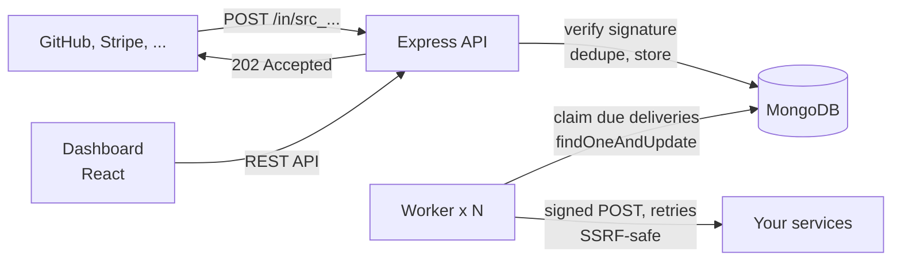

# Hookrelay

**A self-hosted webhook gateway.** Point GitHub, Stripe or any service that sends webhooks at
Hookrelay. It checks the signature, stores the event, answers the sender in milliseconds, and
delivers the event to your services with signed requests, retries and a dashboard that shows
every attempt. Built with Express, MongoDB and React.

[](https://github.com/qaweem321/hookrelay/actions/workflows/ci.yml)


## Why

Receiving webhooks directly is fragile: if your service is down or slow when Stripe calls, the event
is retried on the provider's schedule, or lost. Hookrelay sits in front of your services:

- **Never miss an event.** Events are stored before the sender gets its `202`. Deploys, crashes and
  outages on your side become retries, not lost data.
- **See what happened.** Every event with its headers and body, and every delivery attempt with the
  status code, response and timing.
- **Fix and replay.** Retry failed deliveries one by one or all at once, or replay any event.

## Features

- **Signature checks** for GitHub, Stripe, [Standard Webhooks](https://www.standardwebhooks.com)
  (Svix, Clerk, Resend and others) and custom HMAC-SHA256 headers, with replay protection.
  Rejected requests are counted on the source, with the reason.
- **Deduplication** of provider retries by their event IDs, enforced by a unique index.
- **Fan-out and filters**: one source can feed many destinations, and a destination can subscribe
  to event types like `invoice.paid` or `customer.*`.
- **Retries** with exponential backoff and jitter over about a day, honouring `Retry-After`.
- **Signed deliveries** per the Standard Webhooks spec, with a stable `webhook-id` per delivery so
  receivers can ignore duplicates.
- **Pause** a destination during maintenance; its deliveries wait and go out when you resume.
- **SSRF protection**: destinations can't reach private or cloud-metadata addresses unless allowlisted.
- **Dashboard**: 24-hour stats and chart, events, deliveries, sources, destinations and team members.
  Responses are compressed and each page loads its own code on demand. Light, dark or system theme
  in Settings.
- **Scales out**: run as many workers as you like; claims are atomic.
- **Retention**: events expire after 14 days by default (TTL index).

## Quick start

You need Docker.

```bash
git clone https://github.com/qaweem321/hookrelay.git
cd hookrelay
docker compose --profile app up -d --build
```

Open http://localhost:3500 and log in as `admin@example.com` / `hookrelay-demo`.

The demo adds a "Demo shop" source with 12 sample events and a destination pointing at a small
receiver (`examples/receiver.mjs`) that checks signatures and fails 20% of requests on purpose, so
you can watch retries happen. Watch it with `docker compose logs -f receiver`.

Send your own event:

```bash
curl -X POST <the source's URL from the dashboard> \
  -H 'content-type: application/json' \
  -d '{"type":"order.paid","id":"evt_123"}'
```

These passwords and keys are for local use only. Change them before deploying.

## How it works



1. A provider sends `POST /in/<source>`. Hookrelay checks the signature against the raw bytes,
   stores the event and creates one delivery per matching destination.
2. A worker claims a due delivery atomically, POSTs the original body with Standard Webhooks
   headers, and records the attempt.
3. A failure schedules the next attempt (10 s, 1 min, 5 min, 30 min, 2 h, 6 h, 12 h). After the last
   one the delivery is marked failed and shows on the dashboard.

[docs/DECISIONS.md](docs/DECISIONS.md) explains the design choices and their trade-offs.

## Verifying deliveries in your service

Each delivery carries `webhook-id`, `webhook-timestamp` and `webhook-signature` headers. Use any
[Standard Webhooks library](https://github.com/standard-webhooks/standard-webhooks/tree/main/libraries)
with the destination's signing secret (Destinations → Reveal), or copy the `verify` function in
[`examples/receiver.mjs`](examples/receiver.mjs).

## Development

```bash
docker compose up -d mongo
cp .env.example .env
npm ci
npm run dev        # API on :3500 (with the worker), dashboard on http://localhost:5173
```

| Command                      | What it does                                                   |
| ---------------------------- | -------------------------------------------------------------- |
| `npm test`                   | Vitest: unit, API (Supertest + in-memory MongoDB) and UI tests |
| `npm run check`              | Lint, format check, typecheck and tests, like CI               |
| `npm run build`              | Dashboard (Vite) and server bundles (esbuild) into `dist/`     |
| `npm run worker`             | A standalone delivery worker                                   |
| `npm run seed`               | Demo data (see the `SEED_*` variables in `scripts/seed.ts`)    |
| `node examples/receiver.mjs` | A local destination that prints what it receives               |

Commits follow [Conventional Commits](https://www.conventionalcommits.org/). A commit-msg hook
(commitlint) rejects other formats, and lint-staged formats staged files.

## Configuration

| Variable                  | Default                 | Notes                                                        |
| ------------------------- | ----------------------- | ------------------------------------------------------------ |
| `MONGO_URL`               | (required)              | `mongodb://` or `mongodb+srv://`                             |
| `ENCRYPTION_KEY`          | (required)              | 64 hex characters (`openssl rand -hex 32`); encrypts secrets |
| `APP_URL`                 | `http://localhost:3500` | Public URL; ingest URLs start with it                        |
| `PORT`                    | `3500`                  |                                                              |
| `RUN_WORKER`              | `false`                 | Run the worker inside the API process                        |
| `WORKER_CONCURRENCY`      | `10`                    | Deliveries sent in parallel per worker                       |
| `RETENTION_DAYS`          | `14`                    | How long events and deliveries are kept                      |
| `MAX_PAYLOAD_BYTES`       | `1000000`               | Larger webhooks get `413`                                    |
| `DESTINATION_ALLOW_HOSTS` | (none)                  | Hosts that may resolve to private addresses, comma-separated |
| `ALLOW_HTTP_DESTINATIONS` | `false`                 | Allow `http://` destinations                                 |
| `TRUST_PROXY`             | `false`                 | Set behind a reverse proxy, so rate limits see client IPs    |
| `LOG_LEVEL`               | `info`                  | Pino log level                                               |

The app refuses to start with a list of every invalid variable.

## Tech

Node 24, TypeScript, Express 5, Mongoose 9 (MongoDB 8), Zod, Pino, Helmet, compression · React 19, React Router,
TanStack Query, Tailwind CSS 4, Vite · Vitest, Supertest, mongodb-memory-server, Testing Library ·
ESLint, Prettier, commitlint, husky · Docker, GitHub Actions.

## Maintenance

Hookrelay is maintained in my spare time. Security reports come first; other issues and pull
requests are welcome, but replies may take a while.

## License

MIT
